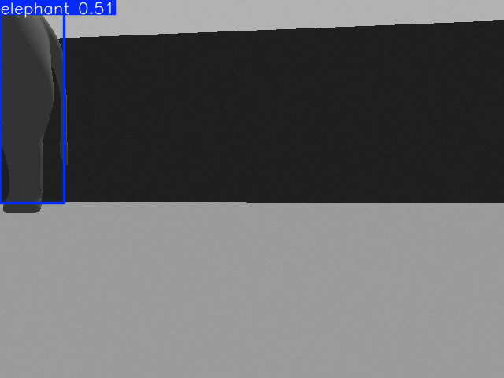

# YOLOv8 Human & Elephant Pose Estimation in a Gazebo Zoo (ROS 2)

  

A ROS 2 Humble package that runs **YOLOv8 pose estimation** on a TurtleBot3 Waffle Pi camera inside a custom **Gazebo "enclosed zoo"**. Two models run on every frame: the pretrained **human** pose model and a **custom-trained elephant keypoint model**. The node publishes an annotated image stream and keypoint markers for RViz.



## Features

- **Two YOLOv8-pose models** per frame: `yolov8n-pose.pt` (humans, COCO keypoints) and a custom elephant model (`models/best.pt`, used by default; `custom_elephant.pt` is an alternative elephant checkpoint)
- **Custom Gazebo world** `enclosed_zoo.world`: a walled 10 × 10 m enclosure with a 3D elephant
- **Human models included** (`models/person1`, `models/person3`) for adding people to the scene
- **Outputs:** annotated image (`/pose_estimation/annotated_image`) and keypoints as `MarkerArray` (`/pose_estimation/markers`)
- **Follow controller (experimental, disabled):** proportional turn and keep-distance logic for a detected person is in the node, but publishing to `/cmd_vel` is commented out, so the robot stays still

## Nodes

| Node | Subscribes | Publishes |
|---|---|---|
| `pose_detector_node` | `/camera/image_raw` | `/pose_estimation/annotated_image`, `/pose_estimation/markers` |
| `pose_visualizer_node` | — | Placeholder; visualisation currently happens in the detector |

**Parameters:** `human_model_path`, `elephant_model_path` (default `best.pt`, resolved from the package's `models/`), `camera_topic`, `conf_threshold` (default 0.5).

## Run it (Ubuntu 22.04 / WSL2 + ROS 2 Humble)

```bash
sudo apt install git-lfs ros-humble-gazebo-ros-pkgs ros-humble-turtlebot3* ros-humble-cv-bridge
pip install ultralytics

git lfs install
git clone https://github.com/Ark4426/ros2-yolo-pose-estimation-zoo.git   # pulls the .pt weights and .dae meshes via LFS
cd ros2-yolo-pose-estimation-zoo
colcon build --symlink-install && source install/setup.bash
export TURTLEBOT3_MODEL=waffle_pi

# Everything: Gazebo zoo + robot + YOLO detector + RViz
ros2 launch pose_estimation pose_estimation_zoo.launch.py

# or only the simulation
ros2 launch pose_estimation zoo_simulation.launch.py
```

The package registers its `models/` folder with Gazebo (via the `gazebo_model_path` export in `package.xml`), so `model://elephant` resolves without changing `GAZEBO_MODEL_PATH`.

## Tested

Verified on ROS 2 Humble + Gazebo 11 under WSL2 (Nov 2026), CPU only: the zoo world loads in seconds, both models load, the elephant is detected (conf ≈ 0.5 at the start pose, see image above), and annotated frames publish at about **4 fps** with elephant keypoint markers.

## Skills demonstrated

ROS 2 (rclpy, launch, parameters, QoS) · YOLOv8 pose estimation · custom keypoint model training · Gazebo world & model authoring · RViz markers · Git LFS for large assets
